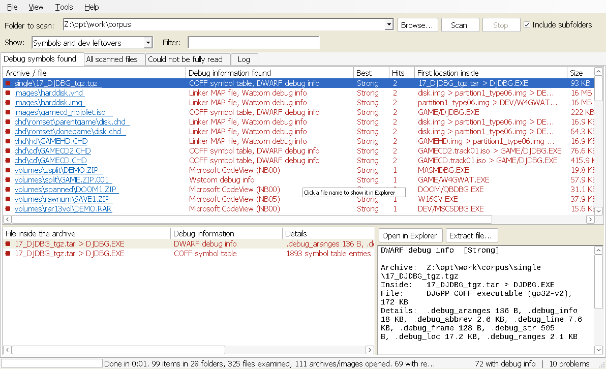

# Symbol Hunter

**Finds leftover debug symbols in DOS-era software hidden inside old archives and disk images.**

Symbol Hunter is a Windows program for retro-software preservation and decompilation. Point it at a folder of old downloads and it recursively opens every archive and disk image inside — nested as deep as they go — and reports which files still contain debug information, and what kind.

It never extracts anything to disk unless you ask. Everything is opened in memory.



## Why

Games and tools from the 1980s–2000s were sometimes shipped, or leaked, with their compiler's debug symbols still attached: function names, variable names, source file names, even line numbers. Those make a decompilation project enormously easier. The catch is that they're buried inside decades-old ZIP/ARJ/LZH/ARC archives, multi-part download sets, and floppy or CD images — often several layers deep. Symbol Hunter digs through all of that for you and flags the files worth a closer look.

## What it detects

- **DOS-era compilers** — Turbo C / C++, Turbo Pascal, Borland C++, Microsoft C, QuickC, QuickBASIC, Zortech/Symantec C++, Watcom C/C++, DJGPP: CodeView (NB00–NB11), Borland Turbo Debugger, Watcom, and COFF/DWARF/stabs debug info.
- **1990s–2000s formats** (24 built-in YARA rules) — Microsoft PDB 2.0 / 7.0, separate `.DBG` files, COFF symbol tables in Windows programs, unstripped ELF with DWARF or stabs, PlayStation Psy-Q `.SYM`, and GNU / CodeWarrior / Visual C++ / Delphi map files, Java debug tables, and debug-runtime builds.
- **Your own rules** — drop any `.yar` file in and it runs alongside the built-ins (libyara 4.6 is embedded, nothing to install).

Each hit is ranked **strong** (a real symbol table), **medium** (a developer leftover), or **weak** (a hint only), so you can go straight to the files that matter.

## Formats it opens

**Archives:** ZIP (PKZIP 0.9 → modern, incl. split/spanned and self-extracting), ARJ, LZH/LHA, ARC/PAK, ZOO, RAR (1.3 → 5.x), ACE, 7-Zip, CAB, plus SZDD/KWAJ, InstallShield 3, PKWARE DCL, gzip, bzip2, xz, compress and tar. Multi-part sets (`abc1.zip`/`abc2.zip`, `.001`, `.C00`, …) are detected and joined automatically.

**Disk images:** FAT12/16/32 floppies and hard disks (IMG, IMA, VFD, DSK, …), DOS 1.x disks, MBR and extended partitions, VHD, ISO 9660 / Joliet / High Sierra CDs, BIN/MDF/NRG/CDI, Teledisk TD0, ImageDisk IMD, CopyQM CQM — including deleted-file recovery.

Archives and images nest freely: a disk image inside an ARJ set inside a ZIP is handled in one pass.

## Download

Grab the latest build from the [**Releases**](../../releases) page. It's a single `SymbolHunter.exe` — no installer.

Requires Windows 10 or 11 (Windows 7 SP1 / 8.1 work with .NET Framework 4.8 installed). The exe isn't code-signed, so SmartScreen may warn on first run — click *More info → Run anyway*, or right-click the exe → *Properties → Unblock*.

## Usage

1. **Folder to scan** — pick a folder; its subfolders are searched too.
2. **Scan** — results stream in as files are found. The **Debug symbols found** tab lists every archive with debug info; click a file name to open its location in Explorer.
3. **All scanned files** shows everything examined; **Could not be fully read** lists damaged or unsupported files.
4. **Tools → Options** adds your own YARA rule files and other settings.

There's also a command-line mode — run `SymbolHunter.exe /?` for the options (`/json`, `/rules`, and more).

## Building from source

Windows, C# / WinForms, .NET Framework 4.8. The build is driven by PowerShell and the Roslyn compiler:

```powershell
pwsh -File build/build.ps1
```

The embedded YARA engine (`native/bin/shyara-*.dll`) is prebuilt and committed; `native/build_win.sh` documents how it's compiled from libyara with a mingw-w64 / LLVM cross-toolchain if you want to rebuild it yourself.

## Third-party code

- [SharpCompress](https://github.com/adamhathcock/sharpcompress) (MIT) — RAR and 7-Zip decoding
- [libyara](https://github.com/VirusTotal/yara) (BSD-3-Clause) — the YARA engine, built with the mingw-w64 runtime and LLVM compiler-rt
- The ACE decoder follows [acefile](https://github.com/droe/acefile) by Daniel Roethlisberger (BSD-2-Clause)

## License

No license has been chosen yet, so default copyright applies and no reuse permissions are granted until one is added.
